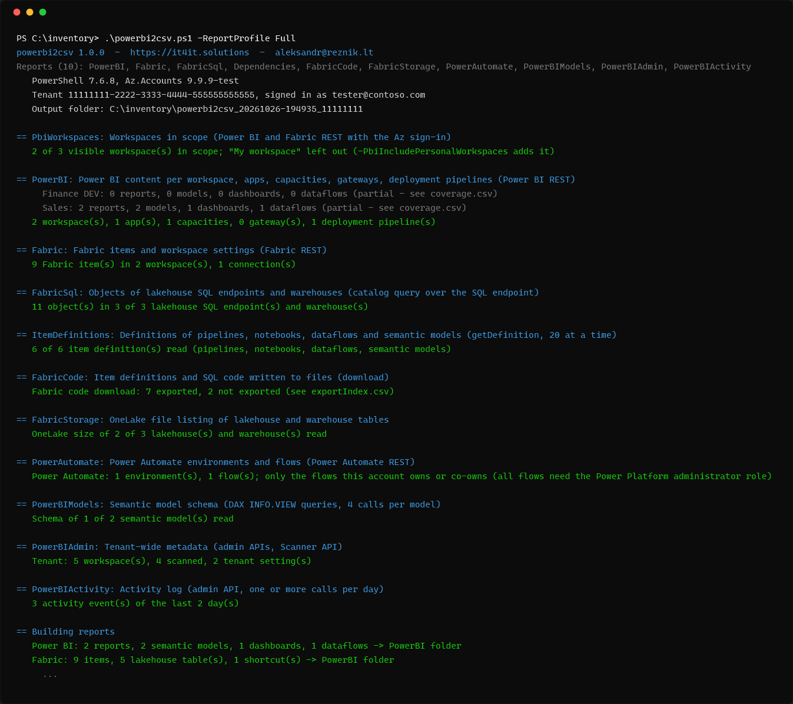

# powerbi2csv

Read-only inventory of a **Power BI / Microsoft Fabric tenant to CSV files**: workspaces, reports, semantic models,
dataflows, lakehouses, warehouses, notebooks, pipelines, who has access, what depends on what, which SharePoint
sites and SQL servers it all reads from, and the code behind it. One PowerShell script; the Az sign-in of a normal
workspace member is enough, the Fabric administrator role adds the whole tenant.



Built for tenant-to-tenant migrations, clean-ups and documentation, as the sibling of
[azure2csv](https://github.com/AleksandrReznik/Azure2csv): same structure and helpers, so that the Power BI blocks
can be merged into it. Background and examples: [blog post on it4it.solutions](https://it4it.solutions/2026/10/23/powerbi2csv-power-bi-fabric-tenant-inventory/).

## Quick start

```powershell
Install-Module Az.Accounts -Scope CurrentUser     # once
Invoke-WebRequest https://raw.githubusercontent.com/AleksandrReznik/powerbi2csv/main/powerbi2csv.ps1 -OutFile powerbi2csv.ps1
Connect-AzAccount                                  # the script reuses this sign-in
.\powerbi2csv.ps1                                  # Standard profile, every workspace the account can see
.\powerbi2csv.ps1 -ListReports                     # the report catalog
```


Requirements: Windows PowerShell 5.1 or PowerShell 7, `Az.Accounts` 2.7.0 or newer. `ImportExcel` is optional (adds
an .xlsx workbook). No app registration, no secrets, no admin role needed. Tested on Windows; the `FabricSql` report
needs outbound TCP 1433. The browser session at app.powerbi.com is not used.

A complete run against a small fictional tenant is in [`docs/sample`](docs/sample).

## What you get

A folder `powerbi2csv_<yyyyMMdd-HHmmss>_<tenant>` with:

| File | Content |
|---|---|
| `PowerBI\*.csv` | the reports below (UTF-8 with BOM, every field quoted) |
| `findings.csv` | things worth a look: failed refreshes and runs, single-admin workspaces, owners who left, workspaces you cannot see, items only in DEV, public links, ... |
| `coverage.csv` | per workspace and area: `Collected`, `Partial` (with the calls that were refused) or `Skipped` |
| `<stamp>__general_log.txt`, `<stamp>__run.json` | log and machine-readable summary (options, stages, API calls, files) |
| `<run>.xlsx` | all reports as sheets, when `ImportExcel` is installed and `-NoExcel` is not used |

## Reports

| Report | Profile | Needs | Files in `PowerBI\` |
|---|---|---|---|
| `PowerBI` | Standard | workspace member | `workspaces`, `workspaceUsers`, `reports`, `reportPages`, `reportDatasources`, `semanticModels`, `semanticModelDatasources`, `semanticModelUsers`, `semanticModelParameters`, `refreshSchedules`, `refreshHistory`, `dashboards`, `dashboardTiles`, `dataflows`, `dataflowDatasources`, `dataflowTransactions`, `lineage`, `apps`, `appContent`, `capacities`, `capacityWorkloads`, `refreshables`, `gateways`, `gatewayDatasources`, `gatewayDatasourceUsers`, `deploymentPipelines`, `pipelineStages`, `pipelineStageItems`, `pipelineUsers`, `pipelineOperations`, `availableFeatures` |
| `Fabric` | Quick, Standard | workspace member | `workspaces`, `fabricItems` (every item type, with folder path, tags, logical ID, last run), `folders`, `workspaceRoleAssignments`, `onelakeRoles` (OneLake security roles of lakehouses), `workspaceGit` (connection and number of uncommitted / incoming items), `gitItemStatus`, `workspaceNetwork` (inbound / outbound policy), `workspaceSparkSettings`, `sparkPools`, `sparkSessions` (latest 200 per workspace), `managedPrivateEndpoints`, `lakehouses`, `lakehouseTables`, `warehouses`, `shortcuts` (target connection, location, subpath), `itemSchedules`, `itemRuns` (run history of pipelines and notebooks), `itemConnections`, `connections`, `deploymentStages`, `deploymentStageItems`, `deploymentRoleAssignments` (deployment pipelines with every item type), `domains`, `environmentMatrix` (the same solution in DEV / TEST / UAT / PROD side by side), `capacities`, `gateways` |
| `FabricSql` | Standard | read on the lakehouse / warehouse, outbound TCP 1433 | `sqlObjects` (tables, views, procedures, functions), `sqlColumns`, `sqlModules` (code of views and procedures), `sqlReferences` (references to other databases). Also fills the counts in `warehouses` and `lakehouses` and the tables of lakehouses with schemas in `lakehouseTables` |
| `Dependencies` | Standard | Contributor (item definitions) | `pipelineActivities` (what each pipeline runs: notebooks, dataflows, procedures with parameters, model refreshes), `notebookDependencies` (attached lakehouses, tables read and written, OneLake paths, notebooks called, URLs), `dataflowSources` (SharePoint site and file, SQL, destination lakehouse), `modelPartitions` (import / Direct Lake / DirectQuery per table), `modelExpressions` (DAX of measures and calculated columns, M queries), `modelRoles` (row-level security), `modelSources`, `itemDependencies` (every item-to-item link in one file), `externalDependencies` (every SharePoint site, SQL server, storage account, URL and who uses it) |
| `PowerBIAdmin` | Standard | Fabric administrator | `adminWorkspaces` (whole tenant, also personal and orphaned; per workspace the scope - personal or shared, with content or empty, not active -, item count, last change seen, changed in the last 30 days, admins and a NoAdmin flag, data source types and gateway use), `workspaceScopeSummary` (the tenant's migration scope on one page), `adminWorkspaceUsers`, `adminItems`, `adminItemUsers`, `adminDatasourceInstances`, `adminModelTables`, `adminModelExpressions`, `tenantSettings`, `adminCapacities`, `adminApps`, `widelyShared`, `adminDomains`, `scan\scanResult_*.json` (complete Scanner API answer) |
| `FabricCode` * | Full, Migration | Contributor (item definitions) | the code as files: `<workspace>\Notebook\<notebook>\notebook-content.py`, `<workspace>\DataPipeline\<pipeline>\pipeline-content.json`, `<workspace>\Dataflow\<dataflow>\mashup.pq`, `<workspace>\SemanticModel\<model>\definition\*.tmdl`, every other item type that has a definition, `<workspace>\dataflows\*.json` (gen1), `<workspace>\sql\<database>\*.sql` (with `FabricSql`), and `exportIndex`. No report files, no data |
| `FabricStorage` * | Full, Migration | read on the lakehouse / warehouse | `onelakeStorage` (size per lakehouse and warehouse), `onelakeTableSizes` (files and bytes per table) |
| `PowerAutomate` * | Full, Migration | flow owner; Power Platform administrator for all flows | `flowEnvironments`, `flows` (triggers, connectors, whether a flow uses Power BI) |
| `PowerBIModels` * | Full, Migration | Build permission on the model | `modelTables`, `modelColumns`, `modelMeasures`, `modelRelationships` |
| `PowerBIActivity` * | Full, Security | Fabric administrator | `activityEvents` (last `-PbiActivityDays` days, at most 28) |
| `PowerBIExport` ** | only when named | Contributor | everything of `FabricCode`, plus the report definitions (PBIR) and the report files, which contain data: `exportIndex`, `<workspace>\reports\*.pbix`, `<workspace>\<item type>\<item>\*` (TMDL, PBIR, notebooks, pipelines, ...), `<workspace>\dataflows\*.json`, `<workspace>\sql\<database>\*.sql` |

\* opt-in: in `-ReportProfile Full` or when named. \*\* only when named in `-Reports` / `-AddReports`.

```powershell
.\powerbi2csv.ps1 -ReportProfile Migration -Zip
.\powerbi2csv.ps1 -Reports PowerBI,Fabric -Workspace 'Finance*' -ExcludeWorkspace '*TEST'
.\powerbi2csv.ps1 -AddReports PowerBIExport -Workspace 'Sales'
.\powerbi2csv.ps1 -WorkspaceListFile '.\Fabric Object Inventory.xlsx'
.\powerbi2csv.ps1 -Reports PowerBIAdmin,PowerBIActivity -PbiActivityDays 28      # as a Fabric administrator
```

Other parameters: `-TenantId`, `-OutputPath`, `-PbiIncludePersonalWorkspaces` (your own "My workspace"),
`-PbiRefreshHistory` (entries per model, default 20), `-PbiRunHistory` (runs per pipeline / notebook, default 20),
`-PbiNotebookFormat` (`Source` = Fabric Git format `.py`, default, or `Ipynb`), `-PbiExportMaxSizeMB` (budget for .pbix
downloads, default 1024), `-UseDeviceAuthentication`, `-Delimiter`,
`-PropertiesMaxChars`. See `Get-Help .\powerbi2csv.ps1 -Full`.

### Share-safe scope run for a customer's administrator: -ClientScope

```powershell
.\powerbi2csv.ps1 -ClientScope -WorkspaceListFile .\scope.xlsx
```

For the case where a Fabric administrator of another organisation runs the script and sends you the result. Only the
admin APIs are called, and only what a migration scope needs is collected:

- **Written:** `adminWorkspaces.csv` (type, scope, state, capacity, number of users, workspace admins, item count, last
  change seen, data source types, gateway yes/no), `adminCapacities.csv`, `adminDatasourceInstances.csv` (type and
  gateway only, no server, database, URL or path), `workspaceScopeSummary.csv`, `workspacePlan.csv` (with
  `-WorkspaceListFile`), `findings.csv`, `coverage.csv`, the log and a zip.
- **Not collected at all:** item names in files, users other than workspace admins, data source addresses, model
  schemas, DAX and M, code, tenant settings, sharing links, the activity log. The Scanner API is asked without
  `datasetSchema`, `datasetExpressions` and `getArtifactUsers`, so those never leave the service, and no raw Scanner
  answer is written.
- `-Reports`, `-AddReports`, `-SkipReports` and `-ReportProfile` are ignored; `-Zip` is on. The run prints what it
  collects before it starts. Without the administrator role it stops with a warning and writes only the log and
  coverage.

`workspaceScopeSummary.csv` answers "how many of the tenant's 2,000 workspaces really need a migration" in one
glance: workspaces in the tenant, not active, personal (with content, empty), shared (empty, with content), and of
the shared ones with content how many are on a capacity, use a gateway, have no admin, changed in the last 30 days,
and (with a workspace list) how many are not on it.

### Checking against a list of expected workspaces

`-WorkspaceListFile` takes a `.csv` or `.xlsx` (first sheet, or the sheet named `Workspaces`; the name in the column
`Workspace` or the first column). `workspacePlan.csv` then has one row per listed workspace with `Found`,
`Found (spelled differently)` or `Not visible to this account`, plus the visible workspaces that are `Not on the
list`. The other columns of the file (owner, purpose, to migrate, ...) are carried over as `Listed_<column>`, so the
human decisions sit next to the facts. Finding `PBI-11` lists the workspaces the inventory could not look into.

When the account is a Fabric administrator, the list is compared with the whole tenant instead (`Source` = `Admin
API`, not found = `Not in the tenant`), in both directions: the `Check` column flags listed workspaces that are empty,
personal or not active (finding `PBI-16`), and shared workspaces with content that are not on the list (finding
`PBI-15`: overlooked?). Personal workspaces that are not on the list are left out of the file.

## What the account can see

Everything is read with the rights of the signed-in account, and nothing stops the run when a call is refused: the
call is counted, the workspace gets the status `Partial`, and `coverage.csv` and the `PowerBIProblems` /
`FabricProblems` columns of `workspaces.csv` say which calls.

- **Not a Fabric administrator**: only workspaces the account is a member of. `PowerBIAdmin` and `PowerBIActivity`
  are skipped with that reason. Users of a workspace need the Admin or Member role, users of a semantic model need
  ownership-level rights, item definitions (`Dependencies`, `PowerBIExport`) need Contributor, capacity workloads
  need capacity admin, gateway data sources need gateway admin.
- **Fabric administrator**: `PowerBIAdmin` adds the whole tenant. The per-workspace reports still cover only the
  workspaces the account is a member of (the admin APIs have no refresh history, pages, Fabric item details).

Known gaps:
- `notebookDependencies` finds tables, paths and calls by pattern in the code. Names that are built at run time
  appear as written (`{schema}.{tablename}`), and a table read through a variable is not found. The attached
  lakehouses come from the notebook metadata and are exact.
- `PowerBIModels` (DAX `INFO.VIEW` queries) returns measure names and types but the service leaves the DAX empty
  there. `Dependencies` has the DAX (`modelExpressions.csv`) from the model definition.
- Lakehouses with schemas enabled have no table list API. `FabricSql` reads their tables from the SQL endpoint
  instead (`TablesSource` = `SQL endpoint`; no format or location for those rows).
- `FabricSql` counts user objects only (`is_ms_shipped = 0`). Counts made in the SQL endpoint UI are usually 12
  views higher, because they include the system views of the `sys` and `queryinsights` schemas.
- `FabricStorage` sizes are what is stored in OneLake, including old Delta versions that were not vacuumed.
- `PowerAutomate` sees only the flows the account owns or co-owns, unless it is a Power Platform administrator.
- `environmentMatrix` matches workspaces named `<solution> - DEV/TEST/UAT/PROD` (no suffix = PROD) and item names
  without such a suffix. Items renamed between environments show up as missing.
- The per-item Git status (`gitItemStatus.csv`) needs Git credentials of the account for the repository; when Fabric
  refuses it, `workspaceGit.csv` says so in `ItemStatus` and still has the connection (repository, branch, head).
- OneLake security roles (`onelakeRoles.csv`) need the Admin or Member role on the workspace.
- Type-specific properties are read for lakehouses, warehouses, dataflows, environments (with libraries and Spark
  compute), mirrored databases, eventhouses, KQL databases, SQL databases and Spark job definitions. Other item types
  are listed in `fabricItems.csv` and downloaded by `FabricCode`, without extra columns. Environments, eventhouses,
  mirrored and SQL databases were not present in the tenant this was built against, so those parts ran only against
  empty lists.
- The admin workspace list has no created date. `LastItemChange` is the newest created or modified date of the
  workspace's items as the Scanner API reports them, `ChangedLast30Days` comes from the Scanner API's modified list
  (it looks back 30 days at most), `RecentActivities` from the activity log when `PowerBIActivity` runs.
  `CreatedDate` / `ModifiedDate` are filled only if the API returns them.
- `NoAdmin` means no user, group or app with the Admin role (or the state Orphaned). Whether an admin's account has
  been disabled in Entra ID is not checked.
- The admin parts were built and tested against a fake tenant only: the account this was developed with is not a
  Fabric administrator. Run them on a few workspaces first and check `coverage.csv`.
- Not read: capacity usage (the Capacity Metrics data has no REST API), tenant-wide tags and sensitivity labels
  (Fabric administrator; the item's own tags are in `fabricItems.csv`), external data shares when the tenant setting
  is off.
- CSV cells are cut at `-PropertiesMaxChars` (long view definitions, DAX, M). `PowerBIExport` writes them in full.
- Sovereign clouds are not handled (the API bases are constants at the top of region 3).

## Safety

Only reads:
- GET requests to the Power BI, Fabric, OneLake (file listing only, no file content) and Power Automate REST APIs
  (the Git status call compares the workspace with its branch on the Fabric side; it commits and updates nothing);
- three POST requests that read: `executeQueries` (DAX `INFO.VIEW.*`), `getDefinition` (item definition) and the
  admin `workspaces/getInfo` scan;
- with `FabricSql`, four `SELECT`s on the system catalog (`sys.objects`, `INFORMATION_SCHEMA.COLUMNS`,
  `sys.sql_modules`, `sys.sql_expression_dependencies`) per lakehouse SQL endpoint and warehouse. No user table is
  queried.

Nothing is created, changed or deleted in the tenant. The output contains names, e-mail addresses, connection
details, SQL and DAX code, with `FabricCode` the source of notebooks and pipelines (which can hold keys or passwords
that somebody typed into the code), and with `PowerBIExport` data inside `.pbix` files. Treat the run folder
accordingly.

## Tests

```powershell
.\tests\Run-OfflineTests.ps1 -AllEditions      # Windows PowerShell 5.1 and PowerShell 7, no network
```

The tests dot-source the script (main is skipped), replace the two network seams (`Invoke-A2CHttp`,
`Invoke-A2CSqlQuery`) with a fake tenant (`tests\lib\TestWorld.ps1`) and run the whole pipeline: paging, throttling,
refused calls, long running operations, the Scanner API, the parsers of pipelines, notebooks, dataflows and TMDL,
exports. PSScriptAnalyzer runs too when it is installed.

## Issues and ideas

Missing an item type, a column or a finding? Open an issue with what the API returns for it (names masked) or write
to aleksandr@reznik.lt. The script is read-only by design; requests that would change the tenant are out of scope.

## Merging into azure2csv.ps1

The script has the regions of `azure2csv.ps1` with the same numbers, the helpers (`Write-A2CLog`, `Invoke-A2CRequest`,
`Register-A2CSchema`, `Add-A2CRows`, `Save-A2CCsv`, `Register-A2CFinding`, ...) are copies with the same names and
contracts, and report files are keyed `PowerBI/<name>.csv`, so they land next to `ADO\`. Everything that is specific
to Power BI sits between `# ---- Power BI ----` and `# ---- end Power BI ----`.

1. **Region 1**: add the entries of `$script:A2CReportCatalog` and `$script:A2CDatasetCatalog`, `'Analytics'` to
   `$script:A2CReportGroups`, and the report names to the profiles and to the three `ArgumentCompleter` lists.
2. **Parameters**: add `-Workspace`, `-ExcludeWorkspace`, `-PbiIncludePersonalWorkspaces`, `-PbiRefreshHistory`,
   `-PbiRunHistory`, `-WorkspaceListFile`, `-PbiActivityDays`, `-PbiExportMaxSizeMB` to `param()` and their defaults
   to `New-A2COptions` (workspace names are not split on spaces or commas).
3. **Region 2**: add `pbi`, `fabric`, `sql`, `onelake`, `flow` to `Stats` in `New-A2CRunContext`.
4. **Region 3**: add the four `if ($Kind -eq ...)` lines to `Invoke-A2CHttp`, the `errorCode` line to `Get-A2CError`,
   and paste the Power BI transport block (`Invoke-A2CPbi` ... `Get-A2CPbiObject`). It includes `Invoke-A2CSqlQuery`,
   a second network seam (TDS, not HTTP) that the tests replace too.
5. **Regions 5, 7, 8**: paste the blocks as they are.
6. **Region 10**: in `Invoke-A2CRun` stop when `PbiWorkspaces` failed only if a Power BI report was selected.
7. **Tests**: add the `pbi`, `fabric`, `onelake`, `flow` branches and `Invoke-A2CSqlQuery` to
   `tests\lib\FakeTransport.ps1` and the routes of `tests\lib\TestWorld.ps1` to `New-TWWorld`.

For free after the merge: `-Mask` (the schemas already carry mask kinds such as `:name`, `:upn`, `:guid`) and the
Excel sheets. Still to write there: a Power BI section in the HTML summary (`& $addSection 'powerbi' ...`), mask
keep-patterns, and a link from `capacities.csv` to the `Microsoft.Fabric/capacities` rows of `allResources.csv`.
